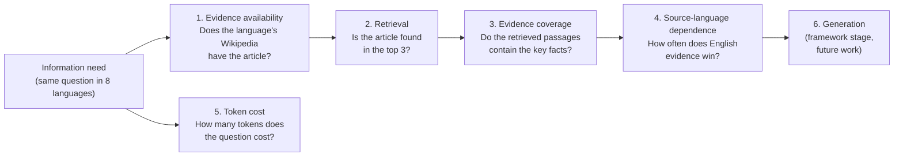
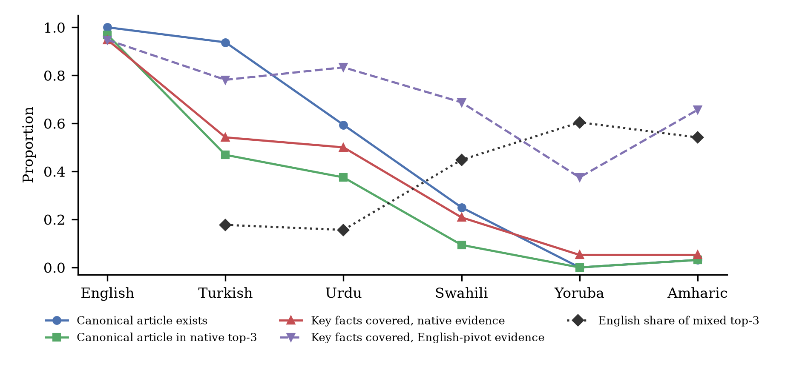
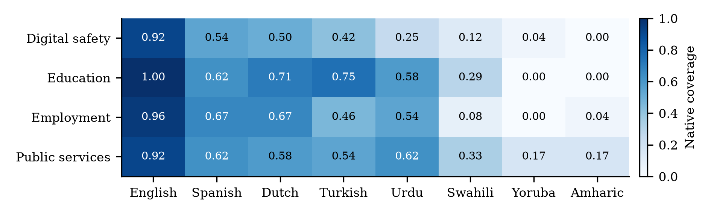

# LinguaParity

**Do multilingual LLMs provide equal access to information across languages?**

Code, data and results for the paper *LinguaParity: Do Multilingual LLMs Provide Equal Access to Information Across Languages?*, accepted at **ICAAD 2026** (International Conference on AI Across Disciplines, Konya, Türkiye, 23 to 25 October 2026).

Inayat Arshad, Department of Computer and Information Sciences, Pakistan Institute of Engineering and Applied Sciences (PIEAS), Islamabad, Pakistan.

Paper: [LinguaParity: Do Multilingual LLMs Provide Equal Access to Information Across Languages?](https://www.researchgate.net/publication/415532766_LinguaParity_Do_Multilingual_LLMs_Provide_Equal_Access_to_Information_Across_Languages)
---

## TL;DR

LLMs are sold as multilingual, and multilingual benchmarks mostly check whether a model *understands and writes* a language. This project asks a more practical question: **if two people ask the same question in different languages, do they get the same information?**

Modern assistants answer from retrieved documents (retrieval-augmented generation, RAG). So LinguaParity follows a single information need through the whole pipeline and measures, stage by stage, where speakers of lower-resource languages lose out.

The main finding is that **most of the inequality is already in place before the LLM writes a single word**:

* For the same 32 everyday questions, the matching Wikipedia article exists in **32/32** cases in English, **19** in Urdu, **8** in Swahili, **1** in Amharic and **0** in Yoruba.
* Evidence retrieved in the user's own language covers **95%** of the key facts in English but only **5%** in Yoruba and Amharic.
* Even large European languages lag behind English: native evidence covers only **61%** of key facts in Spanish and Dutch, although their Wikipedias have over 2 million articles each.
* Switching to English sources recovers much of the gap (Amharic goes from 5% to **66%**), but then a low-resource user is answered from English content written for other countries. When native and English sources compete, English wins **45 to 60%** of the top slots for Swahili, Yoruba and Amharic.
* Asking the same question also costs **1.5x to 4.0x more tokens** than in English.

Better language skills in the model alone will not fix this. The gap sits in the evidence that the model is given.

---

## The idea: multilingual AI as an information-access pipeline

Usual evaluation treats "the model" as one black box and reports one accuracy per language. LinguaParity splits a RAG system into stages so a disparity can be attributed to a specific place:



| Stage | Question it answers | Measure |
|---|---|---|
| 1. Evidence availability | Does knowledge on this topic exist in the user's language? | Canonical article exists in that Wikipedia edition (via interlanguage links); size relative to English |
| 2. Retrieval | Can a retriever find it? | hit@3: canonical article among the top 3 retrieved pages |
| 3. Evidence coverage | Would the model actually receive the facts it needs? | Share of the 3 key facts present in the top-3 evidence passages |
| 4. Source-language dependence | Does the system fall back on English? | Share of English passages in a mixed native + English ranking |
| 5. Token cost | Is the same question more expensive to ask? | Tokens for the question divided by tokens for the English version |
| 6. Generation | Is the final answer complete, consistent, cited and not hallucinated? | Defined in the framework, not reported in this version (see Limitations) |

---

## Benchmark

### Information needs

[`data/information_needs.json`](data/information_needs.json) holds **32 parallel information needs**, 8 in each of four socially relevant domains:

| Domain | Examples |
|---|---|
| Digital safety | phishing, two-factor authentication, ransomware, identity theft, cyberbullying, advance-fee scams |
| Education | scholarships, distance education, literacy, vocational education, student loans |
| Employment | minimum wage, unemployment benefits, trade unions, résumés, child labour, pensions |
| Public services | passports, birth certificates, vaccination, identity documents, voter registration, income tax |

Each need has:

* a natural question, for example *"What is two-factor authentication and why is it useful?"*
* one **canonical English Wikipedia article**, whose introduction is the gold reference
* **three key facts** stated in that introduction, for example *"The user must present two or more distinct types of evidence to gain access."*

The questions are deliberately general rather than country-specific, so the same facts are correct in every language.

### Languages

The eight languages span the resource classes of Joshi et al. (2020) and three scripts. Spanish and Dutch are included as high-resource European reference points, so the low-resource languages can be compared not only with English but with other well-resourced languages:

<!-- languages:start -->
| Language | Script | Resource class | Wikipedia articles (at time of run) |
|---|---|---|---|
| English | Latin | 5 | 7,250,069 |
| Spanish | Latin | 5 | 2,142,571 |
| Dutch | Latin | 4 | 2,229,079 |
| Turkish | Latin | 4 | 702,205 |
| Urdu | Perso-Arabic | 3 | 704,932 |
| Swahili | Latin | 2 | 130,446 |
| Yoruba | Latin | 2 | 41,357 |
| Amharic | Ethiopic | 2 | 15,733 |
<!-- languages:end -->

---

## Method

All models run locally on CPU. No commercial API is used.

1. **Evidence availability** ([`01_collect_evidence.py`](scripts/01_collect_evidence.py)). For each need, fetch the English article and follow its interlanguage links to every other edition, recording whether the article exists and its byte length.
2. **Translation** ([`02_translate.py`](scripts/02_translate.py)). Questions are translated from English with **NLLB-200** (distilled, 600M). Quality is checked with **LaBSE** similarity between each English question and its translation (0.78 to 0.90), and after back-translation (0.81 to 0.96).
3. **Retrieval** ([`03_retrieve.py`](scripts/03_retrieve.py)). The retriever is **model independent**, so it measures what each Wikipedia edition can supply rather than what a particular LLM does:
   * The question's tokens are OR-combined into a lexical CirrusSearch query, and the top 10 pages are kept.
   * Page introductions are reranked by LaBSE similarity to the question, and the top 3 become evidence.
   * This is run three ways:
     * **native**: the user's own edition
     * **pivot**: question machine-translated to English, English Wikipedia searched
     * **mixed**: native and English candidates pooled and reranked together
4. **Evidence coverage** ([`04_evidence_eval.py`](scripts/04_evidence_eval.py)). Each English key fact is compared with every sentence of the evidence using LaBSE cross-lingual similarity, so no translation sits between evidence and judgement. A fact counts as covered when its best match is at least a threshold τ. τ = 0.478 is calibrated on English by maximising Youden's J between a fact and its own article versus an unrelated article (AUC = 1.00). Because the negatives are unrelated articles, this calibration is lenient, so coverage values are upper bounds. Token cost uses the tokenizer shared by Qwen2.5 and Qwen3.
5. **Statistics** ([`05_analyze.py`](scripts/05_analyze.py)).
   * Paired Wilcoxon signed-rank tests over the 32 needs, with Holm correction across the non-English languages.
   * Percentile bootstrap 95% confidence intervals (5,000 resamples).
   * Spearman correlations between availability and coverage.

Every Wikipedia API response is cached, so a run can be repeated against the same snapshot.

---

## Results

### Stage-wise results per language (32 needs)

The tables in this section are generated from `results/` by `scripts/06_readme_tables.py`.

<!-- main:start -->
| Language | Article exists | Native hit@3 | Native coverage | Pivot coverage | Mixed coverage | EN share in mixed | Tokens vs EN |
|---|---|---|---|---|---|---|---|
| English | 1.00 | 0.97 | 0.95 | 0.95 | 0.95 | - | 1.00 |
| Spanish | 0.94 | 0.72 | 0.61 | 0.95 | 0.77 | 0.20 | 1.49 |
| Dutch | 0.84 | 0.59 | 0.61 | 0.84 | 0.86 | 0.25 | 1.50 |
| Turkish | 0.94 | 0.47 | 0.54 | 0.78 | 0.69 | 0.18 | 1.51 |
| Urdu | 0.59 | 0.38 | 0.50 | 0.83 | 0.72 | 0.16 | 3.09 |
| Swahili | 0.25 | 0.09 | 0.21 | 0.69 | 0.58 | 0.45 | 2.04 |
| Yoruba | 0.00 | 0.00 | 0.05 | 0.38 | 0.30 | 0.60 | 3.21 |
| Amharic | 0.03 | 0.03 | 0.05 | 0.66 | 0.57 | 0.54 | 3.99 |
<!-- main:end -->



### What the numbers say

**1. Availability collapses with resource level.** Turkish has the canonical article for 30 of 32 needs, Urdu for 19, Swahili 8, Amharic 1 and Yoruba none. Where articles exist they are much shorter: Turkish articles average **14%** of the size of their English counterparts.

**2. Edition size is a poor proxy for usefulness.** Urdu Wikipedia has about as many articles as Turkish (705k vs 702k) but covers far fewer of these everyday topics. A large article count does not mean the content people need is there.

**3. Native evidence falls far short of English.** Native key-fact coverage drops from 0.95 in English to 0.61 (Spanish, Dutch), 0.54 (Turkish), 0.50 (Urdu), 0.21 (Swahili) and 0.05 (Yoruba, Amharic). Every gap is significant (Wilcoxon, Holm-corrected p ≤ 0.001). At the level of individual needs, whether a native article exists correlates with coverage (Spearman ρ = 0.64, p < 0.001, n = 224).

**4. The gap is not only a low-resource problem.** Spanish and Dutch, both high-resource European languages with Wikipedias of over 2 million articles, still reach only 61% native coverage against 95% for English, and gain significantly from English evidence (+0.33 and +0.23). Information access is English-centric even among well-resourced languages; low-resource languages sit at the far end of the same gradient.

**5. English sources close the gap, at a cost.** Routing the question through English raises coverage significantly in every language:

<!-- pivot:start -->
| Language | Native | English pivot | Gain | Holm p |
|---|---|---|---|---|
| Spanish | 0.61 | 0.95 | +0.33 | < 0.001 |
| Dutch | 0.61 | 0.84 | +0.23 | 0.021 |
| Turkish | 0.54 | 0.78 | +0.24 | 0.021 |
| Urdu | 0.50 | 0.83 | +0.33 | 0.006 |
| Swahili | 0.21 | 0.69 | +0.48 | < 0.001 |
| Yoruba | 0.05 | 0.38 | +0.32 | 0.006 |
| Amharic | 0.05 | 0.66 | +0.60 | < 0.001 |
<!-- pivot:end -->

But a system that serves these users well does so by quietly answering from English. English Wikipedia describes passports, pensions and unemployment benefits mostly from the perspective of high-income countries, so an answer can be complete and still locally irrelevant. The pivot also relies on machine-translating the question, which is weakest for exactly these languages.

**6. The domains that matter most for new internet users are the weakest.** Native coverage by domain:

<!-- domains:start -->
| Domain | EN | ES | NL | TR | UR | SW | YO | AM |
|---|---|---|---|---|---|---|---|---|
| Digital safety | 0.92 | 0.54 | 0.50 | 0.42 | 0.25 | 0.12 | 0.04 | 0.00 |
| Education | 1.00 | 0.62 | 0.71 | 0.75 | 0.58 | 0.29 | 0.00 | 0.00 |
| Employment | 0.96 | 0.67 | 0.67 | 0.46 | 0.54 | 0.08 | 0.00 | 0.04 |
| Public services | 0.92 | 0.62 | 0.58 | 0.54 | 0.62 | 0.33 | 0.17 | 0.17 |
<!-- domains:end -->



For Swahili, Yoruba and Amharic, native evidence covers on average **6%** of digital-safety facts and **4%** of employment facts. Those are the areas (scams, labour rights, benefits) where people most need timely local guidance.

**7. Low-resource users pay more per question.** The same question needs about 1.5x (Spanish, Dutch, Turkish), 2.0x (Swahili), 3.1x (Urdu), 3.2x (Yoruba) and 4.0x (Amharic) as many tokens as English. That means higher cost per query, less room for evidence in a fixed context window, and slower answers.

### Takeaway

These disparities arise **before generation**, so improving the language skills of LLMs alone will not equalise access. What is also needed:

* local-language content on public services, employment, education and online safety
* better multilingual retrieval
* evaluation that checks whether answers are locally relevant, not just fluent

---

## Limitations

* **The generation stage is not reported yet.** Answer completeness, factual consistency, citation quality and hallucination are part of the framework, but running LLMs on CPU was beyond the compute available for this version. The evidence results still bound what any RAG-based answer can contain.
* **Questions are machine-translated** with NLLB-200. Native-speaker review would remove this source of noise.
* **Wikipedia is one knowledge source.** Government portals and local news may cover these topics better in some languages.
* **The needs are general, not country-specific.** This keeps the facts language-independent, but it underestimates the local-relevance problem.
* **LaBSE similarity is a proxy for factual entailment**, and its reliability is probably lower for low-resource languages.
* **Small scale:** 8 languages and 32 needs, so language-level correlations are indicative only.

## Future work

* Add the generation-stage measurements with several open and commercial LLMs.
* Have native speakers validate the needs and their translations.
* Add country-specific information needs that test local relevance directly.
* Extend to more languages and to knowledge sources beyond Wikipedia.

---

## Repository structure

```
linguaparity/
├── data/
│   └── information_needs.json     # 32 needs, canonical articles, key facts
├── linguaparity/                  # shared package
│   ├── config.py                  # languages, models, parameters
│   ├── wiki.py                    # cached MediaWiki API client
│   ├── models.py                  # NLLB-200 translation, LaBSE embeddings
│   ├── text.py                    # multilingual sentence splitting
│   └── io.py
├── scripts/
│   ├── 01_collect_evidence.py     # stage 1: availability
│   ├── 02_translate.py            # questions + translation quality
│   ├── 03_retrieve.py             # stage 2: native / pivot / mixed retrieval
│   ├── 04_evidence_eval.py        # stages 3 to 5: coverage, EN share, tokens
│   ├── 05_analyze.py              # tables, tests, figures
│   └── 06_readme_tables.py        # regenerates README tables from results/
├── results/                       # all intermediate and final results (JSON/CSV)
├── figures/                       # paper figures
└── paper/
    ├── build_paper.py             # writes the paper from the results
    ├── docx_builder.py            # fills the ICAAD 2026 Word template
    ├── LinguaParity_ICAAD26_full_paper.docx
    └── LinguaParity_ICAAD26_full_paper.pdf
```

Every number in the paper is produced by `paper/build_paper.py` directly from the files in `results/`, so the text and the data cannot drift apart.

## Reproduce

Requires Python 3.10+ and about 6 GB of disk space for the models (NLLB-200 600M, LaBSE). No GPU is needed.

```bash
git clone https://github.com/inayatarshad/linguaparity.git
cd linguaparity
python -m venv .venv
.venv/Scripts/pip install torch transformers sentencepiece sentence-transformers python-docx scikit-learn scipy pandas matplotlib requests   # use .venv/bin/pip on Linux/macOS
```

```bash
export PYTHONPATH=.            # PowerShell: $env:PYTHONPATH="."
python scripts/01_collect_evidence.py
python scripts/02_translate.py
python scripts/03_retrieve.py
python scripts/04_evidence_eval.py
python scripts/05_analyze.py
python scripts/06_readme_tables.py
python paper/build_paper.py path/to/ICAAD26_Full_Paper_Template.docx
```

Stages 2 to 4 are incremental: languages that already have results are reused unchanged, so adding a language to `linguaparity/config.py` only computes the new one. Wikipedia is live, so a fresh run reflects the editions on the day you run it. Responses are cached under `data/cache/` after the first run.

## Citation

```bibtex
@inproceedings{arshad2026linguaparity,
  title     = {LinguaParity: Do Multilingual LLMs Provide Equal Access to Information Across Languages?},
  author    = {Arshad, Inayat},
  booktitle = {Proceedings of the International Conference on AI Across Disciplines (ICAAD 2026)},
  address   = {Konya, T{\"u}rkiye},
  year      = {2026}
}
```

## Acknowledgments

Built on open resources: the Wikipedia communities, NLLB-200 (Meta AI), LaBSE (Google) and the Qwen tokenizers (Alibaba).
